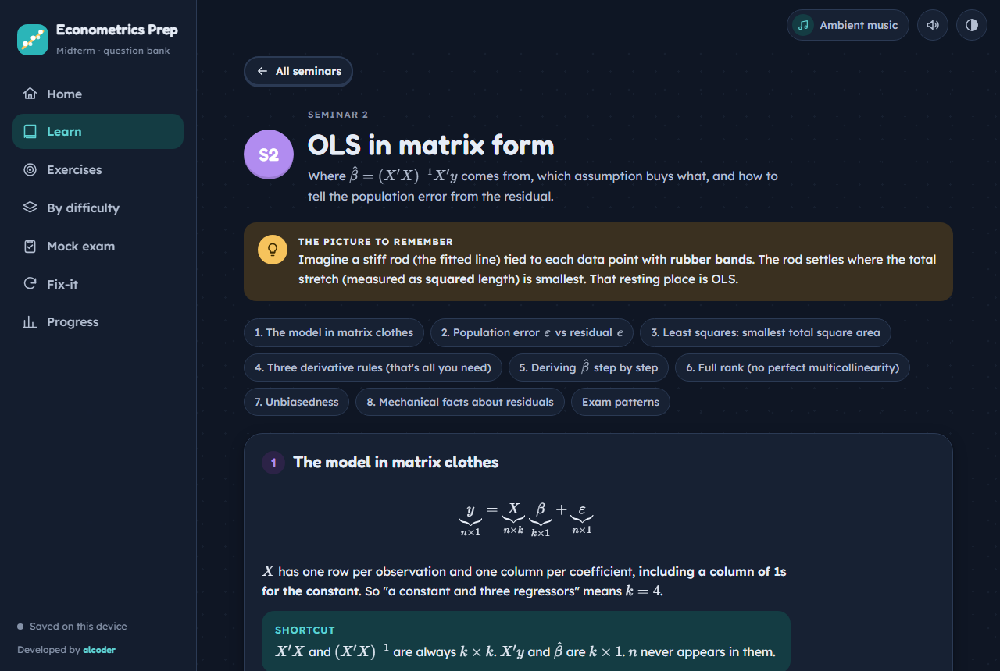

# Econometrics Midterm Prep

A practice site for the WIUT Econometrics (5ECON012C) midterm, built from the module's midterm question bank.

**Open it here: https://alcoder06.github.io/Econometrics-midterm/**

It works in any browser, on a laptop or a phone. There's nothing to install and no account to make.



## What's inside

- **Learn**: one page per seminar (matrix algebra, expected value, OLS in matrix form, standard errors, controls and model fit, dummies and functional forms, plus how to read Stata output). Each page has a simple picture to remember the idea by, worked examples using the bank's own numbers, the traps the wrong options are built from, and interactive visuals.
- **Exercises**: all 211 questions from the bank, grouped by seminar, with a separate combined section for the Stata-output questions. Every question has a seminar badge and a difficulty level, and each answer comes with an explanation of *why*.
- **By difficulty**: practise Easy, Medium or Hard questions across the seminars you choose.
- **Fresh numbers**: the exam changes the numbers, so calculation questions can generate new values each time. The method stays the same.
- **Fix-it deck**: every question you miss is saved. It leaves the deck once you answer it correctly twice in a row.
- **Mock exam**: 20 questions in the real format (3 per seminar plus 2 Stata questions), with an optional timer and a full review at the end.
- **Progress**: mastery and level per seminar, accuracy by difficulty, your weakest topics and your mock exam history.
- Soft sounds for right and wrong answers, and a small ambient music player.

Your progress is saved in your own browser and never leaves it. The public site counts anonymous visits with [GoatCounter](https://www.goatcounter.com) (no cookies, no personal data), such as how many people open each page or finish a mock exam, so I can see which parts are useful.

## Accuracy

The Stata output in the combined section was reproduced from the real datasets (WAGE1, BWGHT, KIELMC, AEJfigs), and every answer was checked against it. The FoS dataset wasn't available, so the answer keys for Stata questions 28, 29, 30 and 32 are inferred and marked **Key unverified** on the site. If you've run those commands, please open an issue with the output.

This is an unofficial study tool and isn't affiliated with WIUT. The questions come from the question bank shared with students by the module leaders.

## Building from source

The site is plain HTML, CSS and JavaScript. The sources are in `src/`, and `build.py` combines them into the single page `index.html`:

```bash
python build.py
```

- `src/q1.js`, `src/q2.js`, `src/q3.js`: the questions, answers and explanations
- `src/gen.js`: the "fresh numbers" generators
- `src/learn.js`, `src/widgets.js`: the theory pages and interactive visuals
- `src/app.js`, `src/audio.js`, `src/styles.css`: the app itself, sound, and styling
- `data/stata_out.py`: reproduces the Stata output in Python from the original datasets

Maths is rendered with [KaTeX](https://katex.org).

---

Built by **[alcoder](https://github.com/alcoder06)**.
